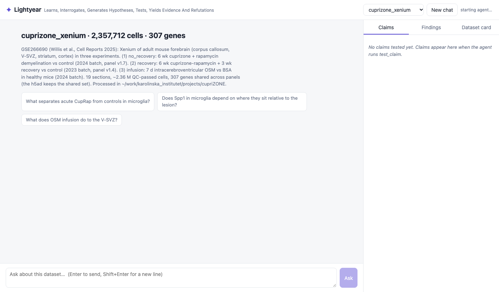

# Lightyear

*A spatial omics agent. To infinity and beyond the cluster.*

**L**earns, **I**nterrogates, **G**enerates **H**ypotheses, **T**ests, **Y**ields **E**vidence **A**nd **R**efutations.

Ask a spatial omics dataset questions in plain language and get answers built from numbers on the full
data, with animals (not cells) as replicates, figures, and every conclusion stress-tested before it is
stated.



## What it is

Lightyear is **not a model of its own**: the reasoning is done by Claude or, in the app, optionally by OpenAI's
Codex. Lightyear gives the model what it needs to be an expert on *one* dataset:

| piece | what it does |
|---|---|
| **Store + dataset card** | Ingest converts an `.h5ad` once into a fast on-disk store and writes a *dataset card*: column meanings, animals per group, cell types and markers, niches, who-neighbours-whom, the main case–control differences and the pitfalls (batch, panel gaps, broad shifts). Claude reads it at the start of every session. |
| **37 tools** (MCP) | Expression, composition, neighbourhoods, niches, gradients, case vs control, annotation help, figures and free Python, all computed **locally** on the full data. Only aggregates and figures go back to the model. |
| **Claims ledger** | Before a finding is stated, `test_claim` tries to break it and records a verdict. |
| **Context model** | The one part that learns: a per-cell-type model of how a cell's expression depends on its neighbours, for "what if" questions. |
| **Memory** | The findings log and claims ledger persist, so the agent builds up knowledge of the dataset across sessions. |

```
                ┌──────────── your Mac ─────────────────────────────────────┐
 question ──▶   │  Claude or Codex (Claude Code, `lightyear gui`, the app)   │
                │     │ plan → tool calls                                     │
                │     ▼                                                       │
                │  Lightyear MCP server ──▶ store/  (1–2 M cells, all genes) │
                │     │ per-animal aggregates, tables, PNG figures            │
                │     ▼                                                       │
                │  test_claim → verdict → claims.json / findings.md           │
                └──────────────────────────────────────────────────────────────┘
 answer   ◀──  numbers per animal · figures · verdicts · caveats
```

## Quick start

**Desktop app (macOS):** build `Lightyear.app` and a `.dmg` with `packaging/build_mac.sh` (see
[Desktop app](#desktop-app)). Drag it to Applications, open it, pick Claude or Codex on the setup screen.

**From source:**

```bash
pip install -e '.[gui,test]'          # '.[app]' adds the native window (pywebview)

# 1. learn a dataset (check the inferred roles first)
lightyear inspect data.h5ad
lightyear ingest data.h5ad stores/<name> --config configs/<name>.yaml

# 2a. chat in the browser (all stores under stores/)
lightyear gui                       # http://127.0.0.1:8790   (--window: native window)

# 2b. or use Claude Code: each store has an MCP server in .mcp.json
claude                              # in this folder; approve the lightyear-* servers
```

The chat app streams the agent's text, every tool call (inputs and outputs, collapsible) and the figures,
with side panels for the claims ledger (verdict badges; click a claim for its tests, per-animal values and
figure), the findings log and the dataset card. Its only tools are the Lightyear tools for that dataset (no
shell, no file access), whichever model is behind it.

### Choosing the model (setup screen)

The first start opens a setup screen (later: the ⚙ button). Settings live in
`~/Library/Application Support/Lightyear/settings.json`; API keys go to the macOS Keychain.

| provider | sign-in options | how it runs |
|---|---|---|
| **Claude** | Anthropic API key (checked against the Anthropic API before saving). When running from source, also your existing Claude Code sign-in. | Claude Agent SDK, with the Lightyear MCP server as its only tools |
| **Codex** | your Codex CLI sign-in (`codex login`: ChatGPT plan or key), or an OpenAI API key | `codex exec --json`, resumed per chat, with shell, apps, plugins, web search and image tools switched off and a read-only sandbox |

Anthropic does not allow third-party apps built on the Agent SDK to offer claude.ai sign-in, so the packaged app
is API-key only for Claude (`LIGHTYEAR_ALLOW_CLAUDE_LOGIN=1` overrides this for your own use). Codex needs the
Codex CLI installed (`npm i -g @openai/codex` or `brew install codex`); the app reuses its sign-in rather than
signing in itself. Codex sessions are saved in `~/.codex/sessions` like any other Codex run.

### Desktop app

```bash
mamba create -p build/env -c conda-forge python=3.10 numpy=1.26 scipy=1.11 scikit-learn pandas=2.1 \
      pyarrow matplotlib h5py anndata=0.11 pyyaml threadpoolctl
build/env/bin/pip install -e '.[app]' pyinstaller
packaging/build_mac.sh            # -> dist/Lightyear.app, dist/Lightyear-<version>-macos-arm64.dmg

# signed + notarised (Developer ID; notary profile created once with `xcrun notarytool store-credentials`)
SIGN_ID="Developer ID Application: …" NOTARY_PROFILE=lightyear-notary packaging/build_mac.sh
```

The app (about 550 MB, a 250 MB `.dmg`) bundles Python, the scientific stack, Lightyear and the Claude Code
binary that the Agent SDK drives. Double-clicked, it opens the chat in its own window. Datasets are read
from `~/Lightyear/stores` (changeable on the setup screen). To add one, drop an `.h5ad` file on the window
(or use **+ Dataset**): the app reads the cell metadata, proposes the replicate, cell type and condition
columns for you to confirm, and runs `lightyear ingest` locally. The binary is also the full CLI
(`Lightyear.app/Contents/MacOS/Lightyear ingest …`). With `SIGN_ID` every library is signed with the hardened
runtime (the bundled Claude Code binary keeps Anthropic's own signature); with `NOTARY_PROFILE` the app and
the `.dmg` are notarised and stapled, so they open without Gatekeeper warnings. Unsigned builds need
right-click → Open the first time. Use conda-forge builds for the environment: pip's SciPy wheels currently
fail to load on recent macOS.

## The claims ledger: conclusions that survived an attempt to break them

Spatial case–control studies usually have 2–6 animals per group, so over-claiming is easy. A finding is a
structured, re-runnable **claim** (an expression change in a population, a composition shift, a
co-localisation, or a context-model prediction). `test_claim` reduces it to **one value per animal** and runs:

| test | asks |
|---|---|
| direction / replicates | right sign, meaningful size, ≥ 2 animals per group |
| separation | is every case animal beyond every control? |
| leave_one_out | does it survive dropping any single animal? |
| permutation | exact animal-label permutation p, reported with the smallest p the design allows |
| spillover | does it survive in cells with no neighbour of the main other source cell type? |
| clean_cells | does it survive in cells with no transcripts of that source's specific markers? |
| niche | does it hold within niches, or is it a niche-composition shift? |
| confident | does it hold in cells with strong identity markers (misannotation, doublets)? |
| specificity | does the gene move the same way in most cell types? |

| verdict | meaning |
|---|---|
| `robust` | survived every test |
| `ambiguous` | replicates agree, but the gene shifts in most cell types and this population is not its main expresser. Diffuse ambient RNA (*Gfap*, *Mbp* in processes) and genuine tissue-wide responses (interferon-induced MHC-I) look identical in expression data, so the agent must decide with prior knowledge and say so |
| `fragile` | the direction holds but a falsification test failed |
| `underpowered` / `not_supported` / `refuted` | < 2 animals in a group / effect absent or too small / opposite direction |

Verdicts are stored in `<store>/claims.json` with a fingerprint of the data each claim used. When the
annotation, a derived column, a model or the expression changes, claims go stale and `recheck_claims`
re-runs them and reports flipped verdicts.

Examples:
- **cupriZONE, acute CupRap vs control (3 v 3):** *Spp1*, *Cybb* up and *Tmem119* down in microglia are
  `robust`; *Mbp* down in microglia and *Gfap* up in oligodendrocytes are `ambiguous`.
- **RRMAP2, chronic peak vs CFA (6 v 5):** *C4b* up in oligodendrocytes, *Serpina3n* up in astrocytes, and
  *P2ry12* down / *Cd74* up in myeloid cells are `robust`. *Gfap* in neurons and *H2-D1* in oligodendrocytes
  are `ambiguous`: the first is almost certainly astrocyte RNA, the second plausibly real MHC-I induction. The
  data flag both, and the call is made explicitly.

## The context model: what if the neighbours were different?

`fit_context_model` learns, per cell type, how expression depends on who surrounds the cell. It is a ridge
regression of each gene on the cell-type composition of the 10 and 30 nearest neighbours (fractions and
square roots), local density and condition. Two design choices keep it honest:

- **Cross-fitted by animal.** Every reported number and every prediction comes from a model that never saw
  that animal.
- **Condition is a covariate.** Neighbourhood effects are learned within condition, so "has lesion cells
  nearby" cannot stand in for "is a diseased mouse".

| tool | answers |
|---|---|
| `context_genes` | which genes depend on the neighbourhood (`r2_context` = held-out variance explained beyond condition), which neighbour raises or lowers each, and whether it looks like **spillover** (the neighbour expresses the gene far more) or a **context-dependent state** |
| `explain_difference` | splits a case–control change into a *neighbourhood part*, a *condition part* and a residual |
| `perturb_neighbourhood` | in-silico edit (remove neighbour types, replace one by another), with a **support check**: do the edited neighbourhoods resemble anything seen in training? |

Model predictions go through the ledger too (`kind="context"` / `"perturbation"`, with model-fit, support
and not-spillover tests). They are associations, not causal effects.

Examples:
- **cupriZONE microglia:** 86% of the *Fn1* and 60% of the *Spp1* increase go with the cells' surroundings
  (lesion clusters); *Cd68* and *Tmem119* shift mostly with condition across all microglia.
  "Remove all microglial neighbours" is flagged as extrapolation (60% support).
- **RRMAP2 oligodendrocytes:** neuronal transcripts (*Snap25*, *Sncb*) are flagged spillover-like; about
  half of the *Serpina3n* increase at peak goes with T-cell proximity.

## Datasets

| MCP server | store | data |
|---|---|---|
| `lightyear-cuprizone` | `stores/cuprizone` | Xenium, 307 genes, mouse forebrain, cuprizone-rapamycin and OSM infusion (GSE266690); 2.36 M cells, 19 sections; dense store |
| `lightyear-rrmap2` | `stores/rrmap2` | Xenium 5K, mouse spinal cord, chronic and relapsing-remitting EAE; 1.38 M cells, 67 animals, 158 tissue pieces; sparse store (5 GB) |

Stores are git-ignored; rebuild them with `lightyear ingest` and the configs in `configs/`.

### Dataset configs

Everything is optional; without a config, roles are inferred from column names and from which columns are
constant within each sample. See `configs/cuprizone.yaml` and `configs/rrmap2.yaml`.

| key | purpose |
|---|---|
| `roles` | `sample` (replicate unit, e.g. animal), `section` (spatial unit if different, e.g. tissue piece: neighbours and distances never cross it), `cell_type`, `group` |
| `combine_columns` | build a group column from others, e.g. `cohort = model + stage`, with value renames |
| `column_roles`, `descriptions` | fix inferred roles, explain columns to the agent |
| `niche_columns` | preferred niche/region columns (card sections, niche stratification in `test_claim`) |
| `contrasts` | case–control pairs summarised in the card |
| `caveats` | known pitfalls written into the card |
| `exclude_cell_types` | classes never used as sources/references (doublet classes are excluded automatically) |
| `sparse`, `organism`, `description`, `expr_description` | storage format, organism for marker/ligand databases, free text |

Config edits apply on re-running `lightyear ingest` without `--rebuild-store` (only the card is rebuilt).

## Tools

| area | tools |
|---|---|
| Orientation | `dataset_card`, `describe_structures`, `column_values`, `list_genes`, `read_findings`, `add_finding` |
| Annotation | `markers` (any categorical column), `annotate` (PanglaoDB + CellMarker matching), `gate`, `score_genes` |
| Expression | `expression`, `compare_groups`, `plot_dotplot`, `plot_sample_bars` |
| Spatial neighbours | `neighbourhood_of`, `neighbourhood`, `nhood_enrichment`, `co_occurrence`, `distance`, `gene_near`, `gradient`, `spatial_autocorrelation`, `plot_spatial` |
| Niches | `compute_niches` (cell-type composition, or annotation-free neighbour-smoothed expression), `composition` |
| Case vs control | `case_control`, `separability` (leave-one-animal-out classifier), `ligand_receptor` (OmniPath, with co-localisation) |
| Context model | `fit_context_model`, `context_genes`, `explain_difference`, `perturb_neighbourhood` |
| Claims ledger | `test_claim`, `list_claims`, `show_claim`, `recheck_claims` |
| Free analysis | `run_python`: saved, numbered scripts in `<store>/analyses/` returning stdout and figures |

New labels made by tools (niches, gates, scores) are saved to `<store>/derived.parquet` and work everywhere,
in later sessions too. The agent's working rules (Plan → Act → Conclude → Verify, and no condition claim
without `test_claim`) live in `.claude/skills/query-dataset/SKILL.md`; the chat app uses the same text.

The same functions work in a notebook:

```python
from lightyear import load, tools, claims
s = load("stores/rrmap2")
print(tools.compare_groups(s, "CH_PEAK1", "CH_CFA", cell_type="Oligodendrocyte"))
spec = claims.make_spec(s, kind="expression", feature="C4b", a="CH_PEAK1", b="CH_CFA",
                        cells={"Anno_L1_curated": "Oligodendrocyte"})
print(claims.test_claim(s, "C4b up in OLs at peak", spec, record=False)["history"][-1]["verdict"])
```

## Store layout

```
stores/<name>/
  meta.json            schema, roles, provenance
  obs.parquet          cell metadata;  derived.parquet: columns created by tools
  spatial.npy          coordinates
  expr.npy             dense gene-major float16   (or expr_csc/: sparse gene-major, for 5K panels)
  knn_idx.npy, knn_dist.npy   30 nearest neighbours per cell, within each section
  card/                card.md + tables/*.parquet
  claims.json          claims ledger;  findings.md: notes
  models/<name>/       context models;  analyses/: run_python scripts;  figures/
```

## Privacy

Tools return aggregates (per animal, group or cell type) and figures, never cell-level tables, so the design
also works for human data where only aggregates may leave the machine. That holds for both providers; for
human data the provider choice decides whose data-processing terms apply. `run_python` is the exception: it runs
arbitrary local code and nothing enforces aggregate-only output. Disable it or review its scripts for human
datasets.

## Limits

- Expression is assumed to be log-normalised (`--layer` picks another layer).
- One store per MCP server (one server per dataset); cross-dataset questions are answered by querying both.
- The context model is linear in composition features (with square-root terms), sees neighbours' cell types
  but not their states, and is associational.
- For panels larger than 1000 genes, the context model fits the 1000 most variable genes plus any requested.
- Chat history in the app is not saved between page reloads (claims and findings are).
- With Codex, answers arrive per message rather than streamed token by token; the app relies on a Codex
  feature flag (`mcp_2026_07_28`) for current MCP servers, which may change between Codex versions.
- `run_python` in the packaged app can import only what is bundled (NumPy, pandas, SciPy, scikit-learn,
  Matplotlib, AnnData and Lightyear).
- Marker databases and OmniPath ligand–receptor pairs are downloaded on first use to `~/.cache/lightyear`.

## Development

```bash
PYTEST_DISABLE_PLUGIN_AUTOLOAD=1 python -m pytest -q
```

Tests use small synthetic datasets with planted effects: a true treatment effect, spillover, ambient RNA, a
tissue-wide response, a neighbourhood-driven gene, and tissue pieces that share a coordinate frame.

Parts of the toolset were inspired by [SpatialAgent](https://github.com/Brogrammer94/SpatialAgent)
(Wang, Regev et al. 2025): marker-database annotation, neighbour-smoothed niches, squidpy-style neighbourhood
statistics and ligand–receptor analysis.
